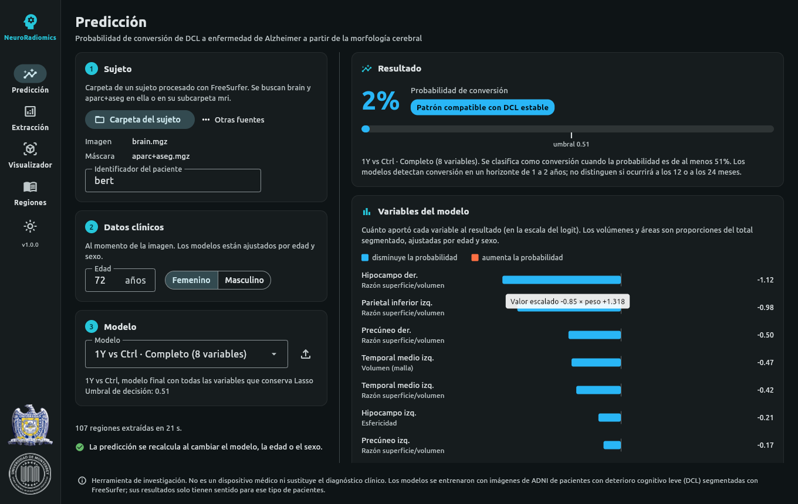
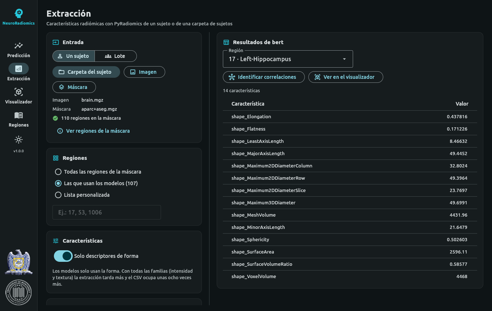
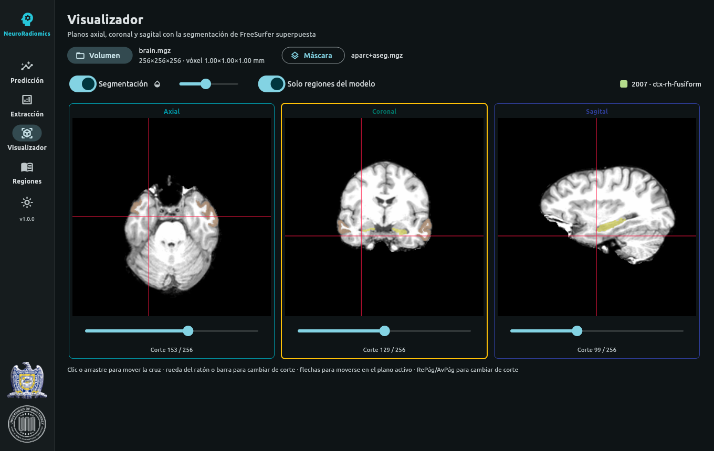

# NeuroRadiomics

Aplicación de escritorio para extraer características radiómicas de forma de resonancias magnéticas cerebrales segmentadas con FreeSurfer y estimar, con modelos de aprendizaje automático interpretables, la probabilidad de que un paciente con deterioro cognitivo leve (DCL) convierta a enfermedad de Alzheimer (EA).



*Sujeto de ejemplo `bert`, incluido con FreeSurfer. La edad y el sexo de la captura son ficticios.*

> **Herramienta de investigación.** No es un dispositivo médico ni sustituye el diagnóstico clínico. Los modelos se entrenaron con imágenes de ADNI de pacientes con DCL segmentadas con FreeSurfer; sus resultados solo tienen sentido para ese tipo de pacientes y ese procesamiento.

## Funciones

- **Predicción.** A partir de la carpeta de un sujeto de FreeSurfer (o de un CSV ya extraído), la edad y el sexo, calcula la probabilidad de conversión con el modelo elegido y muestra cuánto aportó cada variable. Las características se extraen una sola vez: al cambiar de modelo, de edad o de sexo, el resultado se recalcula al instante. También muestra el resultado con todos los modelos disponibles y guarda un reporte en JSON.
- **Extracción.** Características de PyRadiomics de un sujeto o de una carpeta con muchos sujetos (lotes en paralelo), de todas las regiones o de una lista. Se puede extraer solo la forma (lo que usan los modelos) o todas las familias. Cada sujeto se guarda como `<ID>.csv`, con una fila por región.
- **Visualizador.** Planos axial, coronal y sagital con la segmentación superpuesta en los colores de FreeSurfer, el nombre de la región bajo la cruz y la opción de resaltar solo las regiones del modelo. Los planos siguen la convención radiológica (la izquierda del paciente a la derecha de la pantalla y, en el sagital, la cara hacia la izquierda) sin importar la orientación en que esté guardado el archivo.
- **Regiones.** Tabla de etiquetas de FreeSurfer (`FreeSurferColorLUT.csv`) con búsqueda por número o nombre.

| Extracción | Visualizador |
|---|---|
|  |  |

## Arquitectura: dos entornos de Python

| Componente | Carpeta | Python | Motivo |
|---|---|---|---|
| Interfaz | `src/` | 3.14 | [Flet](https://flet.dev/) 1.0, lectura de volúmenes y modelos |
| Backend de extracción | `legacy_service/` | 3.9 | [PyRadiomics](https://pyradiomics.readthedocs.io/) 3.1 solo publica paquetes hasta Python 3.9 |

La interfaz lanza el backend como un proceso aparte por sujeto. El backend lee la imagen y la máscara una sola vez, recorta cada región a su caja delimitadora (los valores no cambian; se verificó contra la extracción sin recorte) y reparte las regiones entre varios procesos. Envía el avance región por región, así que la interfaz nunca se congela y la extracción se puede cancelar. Con el sujeto `bert`, las 107 regiones que usan los modelos se extraen en unos 20 segundos.

Los archivos `.mgz` se convierten a NIfTI con nibabel en una carpeta de caché, así que no hace falta tener FreeSurfer instalado para usar la aplicación (sí para segmentar las imágenes).

## Instalación

Se recomienda [uv](https://docs.astral.sh/uv/), que descarga las versiones de Python necesarias. Desde la carpeta del repositorio:

```bash
# Interfaz (Python 3.14)
uv venv -p 3.14 .venv
uv pip install -p .venv -r requirements-ui.txt

# Backend de extracción (Python 3.9)
uv venv -p 3.9 .venv-backend
uv pip install -p .venv-backend -r requirements-backend.txt
```

Sin uv, con `python3.14 -m venv .venv` y `python3.9 -m venv .venv-backend` y después `pip install -r ...` dentro de cada entorno.

La aplicación busca el backend en `.venv-backend/`. Si está en otro lugar, indique la ruta de su intérprete con la variable de entorno `NEURORADIOMICS_BACKEND_PYTHON` (también se acepta `PY_LEGACY`). Sin backend, la aplicación funciona igual con CSV ya extraídos y con el visualizador.

## Uso

```bash
.venv/bin/python src/main.py        # Windows: .venv\Scripts\python src\main.py
```

### Datos de entrada

Un sujeto procesado con `recon-all` de FreeSurfer. La aplicación busca en la carpeta del sujeto, o en su subcarpeta `mri/`:

- `brain.mgz` (o `.nii`, `.nii.gz`): la imagen sin cráneo.
- `aparc+aseg.mgz`: la segmentación con las estructuras subcorticales y las parcelas corticales del atlas Desikan-Killiany.

Para el modo por lotes, una carpeta con una subcarpeta por sujeto. Si las imágenes están en DICOM, `scripts/dcm2mgz_convert.py` las convierte a `.mgz` antes de segmentarlas.

### Predicción

1. Elija la carpeta del sujeto (o, en *Otras fuentes*, la imagen y la máscara por separado o un CSV ya extraído).
2. Capture la edad y el sexo al momento de la imagen: los modelos están ajustados por ellos.
3. Elija el modelo y presione **Extraer y predecir**.

El resultado se clasifica como *patrón compatible con conversión a EA* cuando la probabilidad alcanza el umbral del modelo. Si alguna variable está muy lejos de los valores del entrenamiento (más de 4 rangos intercuartílicos), la aplicación lo advierte, porque suele indicar un problema de segmentación.

## Modelos

Los modelos están en `models/` y provienen del repositorio [alzheimer-radiomics-ml](https://github.com/MarioAdanPF/alzheimer-radiomics-ml), donde se entrenan y se validan:

- **1Y vs Ctrl:** imágenes tomadas 12 meses antes del diagnóstico de EA frente a pacientes con DCL estable más de 4 años.
- **2Y vs Ctrl:** lo mismo con imágenes tomadas 24 meses antes.

Cada uno tiene una variante **completa** (todas las variables que conserva Lasso) y una **compacta** (las pocas variables que bastan según la eliminación progresiva). Los dos modelos detectan conversión en un horizonte de 1 a 2 años, pero no distinguen si ocurrirá a los 12 o a los 24 meses. La aplicación muestra, para cada modelo, su número de variables, su umbral y su rendimiento en validación cruzada.

### Formato

Cada modelo es un JSON legible (`"formato": "neuroradiomics-modelo"`, versión 1). El pipeline de entrenamiento es lineal, así que se reduce a unas operaciones por variable:

1. Los volúmenes y las áreas se dividen entre el total de esa métrica en las regiones del modelo (normalización por volumen total segmentado).
2. A cada variable se le resta el efecto de la edad y el sexo (`ajuste`, centrado en `covariables[].media`), su mediana (`centro`) y se divide entre su rango intercuartílico (`escala`).
3. El logit es `intercepto + Σ peso × valor escalado`, y la probabilidad, su función logística.

El archivo no contiene datos de pacientes, solo estos parámetros. La implementación (`src/logic/predictor.py`) solo usa la biblioteca estándar de Python y reproduce el pipeline original de scikit-learn con una diferencia en el logit del orden de 1e-11. Otros modelos con este formato se pueden cargar desde la vista de predicción.

## Estructura del repositorio

```
src/
├── main.py                 # Punto de entrada: navegación y contexto compartido
├── logic/
│   ├── extraction.py       # Comunicación asíncrona con el backend (progreso y cancelación)
│   ├── predictor.py        # Modelos portables: carga, predicción y aporte de cada variable
│   ├── volumes.py          # Lectura de volúmenes y conversión de .mgz a NIfTI
│   ├── subjects.py         # Búsqueda de brain y aparc+aseg en las carpetas de FreeSurfer
│   ├── results.py          # CSV de características y reporte de predicción
│   ├── volume_model.py     # Cortes de los tres planos con la segmentación superpuesta
│   ├── lut.py              # Nombres y colores de las etiquetas de FreeSurfer
│   ├── helpers.py          # Correlaciones entre características
│   └── paths.py            # Rutas del repositorio, caché y backend
└── ui/
    ├── prediction_view.py  # Flujo guiado de predicción
    ├── extraction_view.py  # Extracción de un sujeto o por lotes
    ├── volume_view.py      # Visualizador ortogonal
    ├── plane_view.py       # Un plano del visualizador
    ├── info_view.py        # Tabla de regiones
    ├── correlations_dialog.py
    └── common.py           # Estilo y componentes compartidos

legacy_service/extractor.py # Backend de extracción con PyRadiomics (Python 3.9)
models/                     # Modelos de predicción (JSON)
assets/logos/               # Logos de la UAZ y la UDEM
scripts/dcm2mgz_convert.py  # Conversión de DICOM a .mgz con mri_convert
tests/                      # Pruebas con datos sintéticos
FreeSurferColorLUT.csv      # Tabla pública de etiquetas de FreeSurfer
```

## Pruebas

```bash
uv pip install -p .venv -r requirements-dev.txt
.venv/bin/python -m pytest
```

Las pruebas usan solo datos sintéticos. Las de extracción se omiten si no está instalado el backend.

## Datos

Este repositorio no incluye imágenes ni datos de pacientes. Los modelos se entrenaron con datos de [ADNI](https://adni.loni.usc.edu/), sujetos a su acuerdo de uso; para usar la aplicación con imágenes de ADNI se necesita acceso propio a la base de datos. Las capturas de este README usan el sujeto de ejemplo `bert` que se distribuye con FreeSurfer.

## Cómo citar

Este software acompaña la tesis de licenciatura en Ingeniería Biomédica (Universidad Autónoma de Zacatecas):

> Bañuelos Frias, D. P. y Pérez Frias, M. A. (2026). *Predicción de progreso de Deterioro Cognitivo Leve a Alzheimer a partir de Resonancia Magnética*. Universidad Autónoma de Zacatecas.

## Reconocimiento de ADNI

Los datos utilizados para entrenar los modelos se obtuvieron de la base de datos de la Alzheimer's Disease Neuroimaging Initiative (ADNI) ([adni.loni.usc.edu](https://adni.loni.usc.edu/)). Por ello, los investigadores de ADNI contribuyeron al diseño y a la implementación de ADNI o proporcionaron datos, pero no participaron en el análisis ni en la redacción de este trabajo. La lista completa de los investigadores de ADNI se encuentra en el [ADNI Acknowledgement List](http://adni.loni.usc.edu/wp-content/uploads/how_to_apply/ADNI_Acknowledgement_List.pdf).

La recolección y el intercambio de los datos de ADNI están financiados por el National Institute on Aging (National Institutes of Health, subvención U19AG024904). La organización beneficiaria es el Northern California Institute for Research and Education. Anteriormente, ADNI también recibió financiamiento del National Institute of Biomedical Imaging and Bioengineering, de los Canadian Institutes of Health Research y de contribuciones del sector privado a través de la Foundation for the National Institutes of Health (FNIH), incluidas las generosas aportaciones de: AbbVie, Alzheimer's Association; Alzheimer's Drug Discovery Foundation; Araclon Biotech; BioClinica, Inc.; Biogen; Bristol-Myers Squibb Company; CereSpir, Inc.; Cogstate; Eisai Inc.; Elan Pharmaceuticals, Inc.; Eli Lilly and Company; EuroImmun; F. Hoffmann-La Roche Ltd and its affiliated company Genentech, Inc.; Fujirebio; GE Healthcare; IXICO Ltd.; Janssen Alzheimer Immunotherapy Research & Development, LLC.; Johnson & Johnson Pharmaceutical Research & Development LLC.; Lumosity; Lundbeck; Merck & Co., Inc.; Meso Scale Diagnostics, LLC.; NeuroRx Research; Neurotrack Technologies; Novartis Pharmaceuticals Corporation; Pfizer Inc.; Piramal Imaging; Servier; Takeda Pharmaceutical Company; and Transition Therapeutics.

## Licencia

El código se distribuye bajo la licencia [MIT](LICENSE). La licencia no cubre los datos de ADNI, que se rigen por su propio acuerdo de uso.
